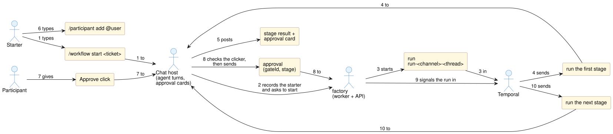

# 01. Concepts

factory runs a piece of work (a ticket, a support report, a request) through ordered stages. An AI agent does each stage in a chat thread, then posts an approval card. A person approves, and the next stage starts. The lifecycle lives in a Temporal workflow, so a gate can wait days and survive any restart.

## Terms

| Term | Meaning |
|---|---|
| **Stage** | One unit of agent work, done in one chat turn, ending with an approval card. Defined by a `StageDef`: a name, where it runs (`host` or `sandbox`), optional gate timers, and `next`, which decides what follows an approval |
| **Pipeline** | An ordered list of stage names plus default gate timers, registered as `name@version`. A run starts at the first stage and follows each stage's `next` |
| **Registry** | One per app. It holds the app's stages, pipelines, prompts and hooks |
| **Prompt** | The text of a stage turn, built from the run's facts, the attempt number and the last rejection note |
| **Run** | One execution of the pipeline workflow. A chat thread has at most one running run; its workflow id is `run-<channelId>-<threadTs>` |
| **Starter** | The person who started the run |
| **Participant** | A person the starter added to the run. The starter and participants are the only people who may approve or reject a stage |
| **Gate** | The wait after a stage. It ends with an approval signal, a reminder timer that nudges the thread (default 24 h), or a give-up timer that cancels the run (default 7 days) |
| **Hook** | An extension point. Event hooks (`registry.on`) run side effects such as tracker labels, metrics or info posts at fixed points of a run. Decision hooks (`skip`, `next`) choose the path |
| **Outcome** | A value a stage reports with its approval, such as `code` or `answer`. `next` reads it to choose the path, for example finishing early when no code change is needed |

## Who does what

| Part | Owns | Does not |
|---|---|---|
| **factory (this repo)** | The pipeline workflow, gates, timers, the registry API, the HTTP API, the dashboard, the contract with the chat host | Run the agent, show cards, touch code or the sandbox |
| **An app** (a separate repo built on factory) | Its stages, pipelines, prompts and hooks; a worker process; deployment | Reimplement gates or the workflow loop |
| **Chat host** (reference: slaude) | Agent turns in the thread; who the starter and participants are; approval cards and the check on who clicked; injecting a stage turn when factory asks | Decide the order of stages or keep the lifecycle |
| **Sandbox** (optional, through the chat host) | Where the agent's code-changing tools run during stages marked `sandbox` | Talk to factory |

## The shape of one run

1. The starter types `/workflow start` in a thread.
2. The chat host records the starter and asks factory to start a run.
3. factory starts the run in Temporal.
4. The run asks the chat host to run the first stage.
5. The agent does the stage and posts an approval card.
6. The starter adds a participant.
7. The participant approves.
8. The chat host checks that the clicker is a participant, then sends the approval to factory.
9. factory signals the run.
10. The run asks the chat host to run the next stage.

[03-engine.md](03-engine.md) walks through one run in full, including rejects, reminders and failures.
