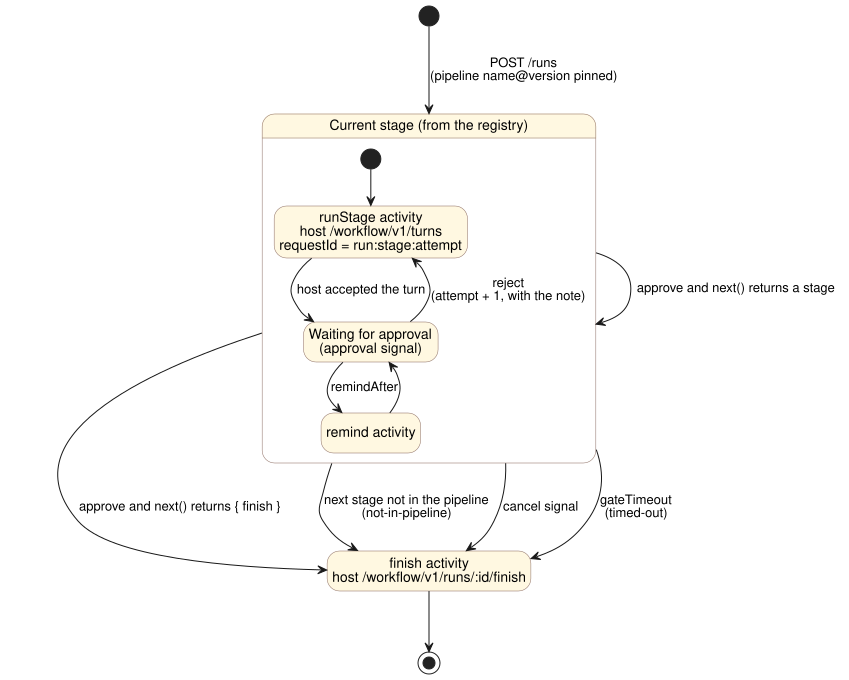

# 03. The engine: one run, step by step

Status: implemented in `src/workflow.ts`, tested in `test/workflow.test.ts`.

One run is one Temporal workflow execution, `run-<channelId>-<threadTs>`. It runs from the first stage to finish. Stages are steps inside it: a stage never starts another workflow.



## The loop

```ts
export function makePipelineWorkflow(registry: Registry) {
  return async function pipelineWorkflow(input: StartRun & { pipelineVersion: number }) {
    const p = registry.getPipeline(input.pipeline, input.pipelineVersion);
    let current = p.stages[0];
    await emit("run.started");
    for (;;) {
      if (!p.stages.includes(current)) return finish("not-in-pipeline");
      const def = registry.getStage(current);
      if (def.skip?.(ctx)) {                          // decision hook, deterministic
        await emit("stage.skipped", current);
        const nxt = def.next(autoApproval(current), ctx);
        if (typeof nxt !== "string") return finish(nxt.finish);
        current = nxt;
        continue;
      }
      const result = await runStageAndWait(def, p);   // the stage turn, then the gate (below)
      if (result.kind !== "approved") return finish(result.kind);   // "cancelled" | "timed-out"
      const nxt = def.next(result.approval, ctx);
      if (typeof nxt !== "string") return finish(nxt.finish);
      current = nxt;
    }
  };
}
```

`runStageAndWait` repeats for one stage until it is approved, or until the run is cancelled or times out:

1. `emit("stage.started")`, then activity `runStage({ runId, stage, attempt, note })`. It builds the prompt and calls the chat host's turn endpoint with `requestId = <runId>:<stage>:<attempt>`. It retries with backoff. The host ignores a repeated `requestId`, so a retry never runs the turn twice.
2. Wait for an `approval` signal for this stage, a `cancel` signal, or a timer:
   - **approve:** `emit("stage.approved")`, the stage is done, and `next` picks what follows;
   - **reject:** `emit("stage.rejected")`, then the same stage runs again as attempt N+1, with the rejection note in the prompt;
   - **`remindAfter` elapsed:** `emit("gate.reminded")`, activity `remind` posts a short nudge in the thread, then the wait continues;
   - **`gateTimeout` elapsed:** the run finishes as `timed-out`;
   - **cancel:** the run finishes as `cancelled`.
3. A repeated `gateId` is ignored. The run keeps the set of gate ids it has seen.

Finish emits `run.finished`, calls activity `finish` (the host posts a closing line), and ends the workflow.

`emit` is one activity for every event. It runs the app's handlers through `dispatchEvent` ([02-registry.md](02-registry.md#hooks)). Because the workflow's commands do not depend on which handlers exist, handlers can be added or removed between deploys without affecting replay.

`runStage` returns as soon as the host **accepts** the turn, not when the agent finishes it. A turn can take minutes, and a code stage much longer. The run waits for the approval instead, which already means a person saw the result. That keeps activities short and their timeouts simple.

## Query `state` (for the dashboard)

The workflow answers a `state` query with `RunState`:
- the current stage and attempt;
- running or finished, and the finish reason;
- when the current gate started waiting;
- the history of every decision (stage, attempt, approve or reject, by, at, note, outcome).

## What the Temporal history looks like

A `ticket@1` run where triage was rejected once:

```
WorkflowExecutionStarted   pipelineWorkflow  ticket@1  starter U1
ActivityTaskCompleted      runStage  intake    attempt 1
WorkflowExecutionSignaled  approval  intake    approve  by U2
ActivityTaskCompleted      runStage  triage    attempt 1
WorkflowExecutionSignaled  approval  triage    reject   by U3  note="check the other service too"
ActivityTaskCompleted      runStage  triage    attempt 2
TimerFired                 remindAfter 24h
ActivityTaskCompleted      remind    triage
WorkflowExecutionSignaled  approval  triage    approve  outcome=code  by U1
ActivityTaskCompleted      runStage  planning  attempt 1
WorkflowExecutionSignaled  approval  planning  approve
ActivityTaskCompleted      runStage  building  attempt 1
WorkflowExecutionSignaled  approval  building  approve
ActivityTaskCompleted      runStage  review    attempt 1
WorkflowExecutionSignaled  approval  review    approve
ActivityTaskCompleted      finish    done
WorkflowExecutionCompleted
```

Counting the scheduled and started events too, that is roughly 60 to 80 events, far below Temporal's history limit. No Continue-As-New is needed unless a stage is rejected dozens of times.

## Why one workflow and not a child per stage

| | One workflow per run (chosen) | A child workflow per stage |
|---|---|---|
| Approvals | One id to signal | The host must know the current child, or the parent forwards every signal |
| Dashboard | One row per run, with the whole history | A parent and N children to join |
| Reject | A loop inside the stage | A new child each attempt |
| Pays off when | A stage is one turn plus a gate | A stage becomes long, multi-step work with its own timers, such as several rounds of code review. That stage alone can become a child later without changing the others |

## Failures

| Case | What happens |
|---|---|
| The chat host is down when a stage starts | `runStage` retries with backoff. `requestId` prevents a double turn |
| The agent's turn crashes and no card appears | `remindAfter` posts a nudge. A participant can also ask the agent in the thread. `gateTimeout` ends the run |
| A double click, or a signal sent twice | Same `gateId`, so it is ignored |
| The worker restarts | Temporal replays the history. Timers and waits continue where they were |
| A pipeline version was edited in place | Replay may fail with a nondeterminism error. Register a new version instead ([02-registry.md](02-registry.md)) |
