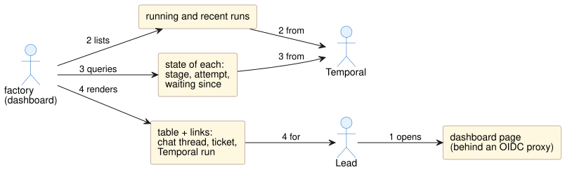

# 06. Dashboard

Status: specified, not built.

A server-rendered page in the factory process. It has no build step and no JavaScript framework, and refreshes every 30 s.

1. A lead opens the dashboard.
2. factory lists running runs, and runs finished in the last 7 days, from Temporal visibility (`WorkflowType = 'pipelineWorkflow'`).
3. It queries `state` on each running run.
4. It renders the table with links.

## `GET /`: all runs

| Column | Source |
|---|---|
| Ticket or request | Run input |
| Pipeline and version | Run input |
| Stage and attempt | `state` |
| Status and finish reason | `state` / visibility |
| Starter | Run input |
| Waiting for approval | `now - state.waitingSince`, highlighted past the stage's `remindAfter` |
| Started | Visibility |
| Links | Chat thread (`CHAT_THREAD_URL` template), ticket (`TICKET_URL` template), Temporal Web UI run (`TEMPORAL_UI_URL`) |

## `GET /runs/:runId`: one run

The `state.history` table: stage, attempt, approve or reject, by whom, when, note and outcome. It also shows the run's input and the pipeline definition it was pinned to.

## Auth

The page has no login of its own. Put it behind an OIDC proxy (for example oauth2-proxy) in shared environments. The API bearer token is never used by a browser.
